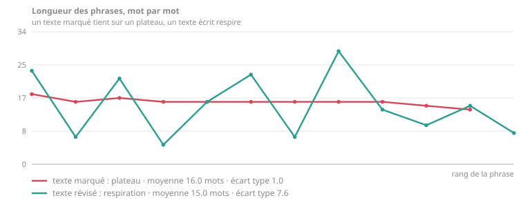

<!-- moliere-lint: contre-exemples -->

# Documentation technique

Ce que le README ne dit pas, pour qui veut comprendre ou modifier le skill.

- [Arborescence](#arborescence)
- [Les trois supports](#les-trois-supports)
- [Les trois modes](#les-trois-modes)
- [Le linter](#le-linter)
- [L'autofixeur typographique](#lautofixeur-typographique)
- [La courbe de rythme](#la-courbe-de-rythme)
- [Le déclencheur automatique](#le-déclencheur-automatique)
- [Le cas du tiret cadratin](#le-cas-du-tiret-cadratin)
- [Régler le skill](#régler-le-skill)
- [Le dépôt se contrôle lui-même](#le-dépôt-se-contrôle-lui-même)
- [Ce que le skill ne fait pas](#ce-que-le-skill-ne-fait-pas)

---

## Arborescence

```
skills/moliere/
├── SKILL.md                  porte d'entrée : quand se déclencher, où aller, quels outils
├── STYLE.md                  les règles. Autoportant, copiable dans n'importe quel assistant
├── references/
│   ├── supports.md           document, publication, présentation
│   ├── marqueurs.md          liste noire des tics de rédaction automatique
│   ├── fautes.md             les fautes de français que les modèles commettent
│   ├── typographie.md        règles typographiques, écriture inclusive
│   ├── exemples-phrases.md   vingt réécritures commentées
│   └── exemples-textes.md    trois textes entiers, avant et après
└── scripts/                  trois outils facultatifs, sans dépendance
```

Un agent lit `SKILL.md` au déclenchement, puis `STYLE.md` avant d'écrire, puis la référence qui
correspond à ce qu'il fait. Rien d'autre n'est chargé.

Le gras et les titres employés dans ces fichiers appartiennent à la consigne, jamais au texte
livré. Ce que le skill s'autorise pour s'expliquer, il ne l'autorise pas dans ce qu'il produit.

## Les trois supports

Le style ne change pas d'un support à l'autre. La longueur, la distance au lecteur et la place de
l'information changent, et rien d'autre.

| Profil | Pour | Ce qui change |
|---|---|---|
| `document` *(défaut)* | Devis, proposition, note, rapport, compte rendu. Un courriel est un document court | Plan apparent, distance, troisième personne, attribution des sources. Un devis engage : verbe précis, chiffre opposable, date, et pas de litote |
| `post` | Publication courte, billet, message de communauté | Le « je » et l'adresse au lecteur sont autorisés, le staccato toléré une fois, l'attaque doit tenir avant la coupure du « voir plus » |
| `presentation` | Diapositives, quel que soit l'outil | Le titre porte le message et non le sujet, douze mots par puce, pas de point final, la prose descend dans les notes |

Une diapositive n'a ni attaque, ni chute, ni rythme : le linter ne contrôle pas ces trois points en
profil `presentation`. Il y contrôle en échange deux choses que les autres supports ignorent, la
longueur des puces et leur ponctuation finale.

Le détail est dans [`supports.md`](skills/moliere/references/supports.md), le seul fichier du dépôt
qui parle d'un support plutôt que de la langue.

## Les trois modes

| Mode | Quand | Ce qu'il rend |
|---|---|---|
| Rédaction | Vous partez de rien | Le texte, sans commentaire sur le processus |
| Révision | Le texte existe, il est faible | Le texte refait, puis les interventions par nature de défaut |
| Épuration | Le texte est bon, il sent la machine | Le même texte, une phrase sur trois retouchée au plus |

En mode révision, le skill ne rend jamais un texte annoté : vous voulez publier, pas corriger une
copie. Si un choix est contestable, il propose deux variantes de la phrase concernée plutôt que
d'imposer la sienne.

Le budget du mode épuration, une phrase sur trois, n'est pas mesuré par un outil. C'est une limite
déclarative, et [`CRITIQUE.md`](CRITIQUE.md) §10 le reconnaît.

## Le linter

`skills/moliere/scripts/moliere_lint.py` fait ce qu'un modèle de langue rate : compter. Il mesure,
ne corrige rien, et ne juge pas le style.

```bash
python3 skills/moliere/scripts/moliere_lint.py FICHIER... [options]

  --profil document|post|presentation   défaut : document
  --controles tout|typo                 typo : typographie seule
  --seuil N                             score minimal exigé
  --strict                              code retour non nul si constat bloquant
  --json                                sortie machine
  --version
```

Un répertoire passé en argument est parcouru récursivement ; seuls les fichiers `.md` et `.txt`
sont retenus.

### Ce qu'il mesure

**Typographie**, toujours actif, y compris avec `--controles typo` : tirets cadratins et
demi-cadratins, guillemets droits, points décimaux, ordinaux fautifs, puces à emoji, caractères
mathématiques Unicode employés comme gras, points de suspension, exclamations au-delà du quota du
profil, gras dans un profil qui l'interdit.

**Langue** : participes présents en queue de phrase, énumérations ternaires d'adjectifs, antithèses
binaires répétées, chapeaux annonciateurs, calques de l'anglais, abréviations de jargon, sigles non
développés, adresse creuse au lecteur.

**Rythme** : moyenne et écart type des longueurs de phrase, plateaux métriques (quatre phrases
consécutives dans une fourchette de quatre mots), staccato, phrases d'un seul mot, ouvertures de
paragraphe identiques, répétition d'un mot saillant sous quarante mots.

**Structure** : longueur de l'attaque en caractères, chute plus longue que l'avant-dernière phrase,
chute récapitulative, attaque ouvrant sur une généralité, question rhétorique en ouverture.

**Ancrage** : présence d'au moins un chiffre, un nombre écrit, une date ou un nom propre.

**Plateforme** : nombre de mots-dièse, mots-dièse génériques, longueur totale, longueur des puces
et ponctuation finale en profil `presentation`.

### Le score

Quatre sévérités, quatre poids. Le score part de 100 et retranche.

| Sévérité | Poids | Ce qu'elle signifie |
|---|---|---|
| `bloquant` | 12 | Règle absolue, ou marqueur qui suffit seul à trahir le texte |
| `defaut` | 6 | Défaut fort, qui se lève pour un motif nommé |
| `alerte` | 3 | Heuristique incertaine, à arbitrer par un humain |
| `info` | 0 | Mesure, sans jugement |

**Le score est une commodité de lecture, pas une grandeur.** Rien ne justifie qu'un tiret cadratin
vaille six points et une énumération ternaire six aussi. Il sert à voir une progression sur un même
texte et à poser un seuil en intégration continue. Deux textes à 80 ne sont pas comparables. Les
constats individuels sont la vraie sortie.

### Les faux positifs

Trois contrôles reposent sur des heuristiques et se trompent par construction. Un linter de style
sans faux positif est un linter qui ne trouve rien.

- **Participe présent en queue.** La détection s'appuie sur une liste de mots en `-ant` qui ne sont
  pas des participes. Elle est incomplète et le restera.
- **Énumération ternaire.** Un mot est jugé adjectif d'après son suffixe. « Nous concevons,
  industrialisons et maintenons » échappe à la détection, à raison ; d'autres cas passeront à tort.
- **Répétition rapprochée.** Le seuil de neuf lettres écarte les parallélismes voulus, mais laisse
  passer des répétitions légitimes de termes techniques.

Le compromis retenu : les heuristiques incertaines sortent en `alerte`, jamais en `bloquant`, et le
message donne toujours le texte incriminé pour qu'un humain arbitre. Signaler un faux positif avec
le texte qui le déclenche est la contribution la plus utile au dépôt.

### Les contre-exemples

Un fichier qui cite délibérément ce qu'il proscrit se déclare. Tous ses constats passent alors en
`info`, et l'autofixeur l'ignore.

```markdown
<!-- moliere-lint: contre-exemples -->
```

## L'autofixeur typographique

`skills/moliere/scripts/typo_fix.py` corrige le mécanique et le réversible, jamais le style.

```bash
python3 skills/moliere/scripts/typo_fix.py FICHIER...              # montre le diff
python3 skills/moliere/scripts/typo_fix.py FICHIER... --ecrire     # applique
python3 skills/moliere/scripts/typo_fix.py FICHIER... --insecables # ajoute les espaces insécables
python3 skills/moliere/scripts/typo_fix.py FICHIER... --forcer     # ignore la déclaration de contre-exemples
```

Il traite les guillemets droits, les ordinaux fautifs, les tirets espacés en incise, et sur demande
les espaces insécables. Il protège les blocs de code, le frontmatter, les commentaires et les
balises HTML, le code en ligne et les URL.

La séparation avec le linter est délibérée. Un outil qui corrige la typographie peut agir seul ; un
outil qui corrigerait le style prendrait des décisions qui appartiennent à l'auteur.

Ce que ni l'un ni l'autre ne couvre : l'orthographe, les accords, la conjugaison. Voir
[`correcteurs.md`](skills/moliere/scripts/correcteurs.md) pour les ponts vers LanguageTool,
Grammalecte et Hunspell.

## La courbe de rythme

L'uniformité métrique ne se lit pas, elle se trace.

```bash
python3 skills/moliere/scripts/courbe_rythme.py avant.md apres.md \
  -o rythme.svg --titres "avant" "après"
```

Un à quatre textes, sortie SVG lisible en thème clair comme en thème sombre, sans dépendance.

<p align="center">
  
</p>

Le texte généré tient sur un plateau : onze phrases de quatorze à dix-huit mots, écart type 1,0. Le
texte révisé alterne des phrases de cinq et de vingt-neuf mots, écart type 7,6, pour une moyenne
quasi identique. C'est la même longueur moyenne et ce n'est pas la même langue.

## Le déclencheur automatique

Un `hook PostToolUse` qui lance le linter à chaque écriture de fichier rendrait les règles
réellement contraignantes. Il n'est pas activé ici, parce qu'un déclencheur s'exécute chez celui
qui l'installe et que personne n'aime le découvrir après coup. La procédure complète est dans
[`hook-exemple.md`](skills/moliere/scripts/hook-exemple.md).

## Le cas du tiret cadratin

Le skill le proscrit par défaut. Il dit aussi pourquoi, et ce n'est pas la raison qu'on donne
d'habitude.

Le tiret cadratin n'est **pas** une faute en français. Le *Lexique des règles typographiques en
usage à l'Imprimerie nationale* l'admet en incise et le prescrit pour le dialogue, et la
littérature française en use depuis toujours. Prétendre le contraire, c'est se faire corriger par
le premier lecteur compétent.

Le motif est statistique : depuis 2023, un texte professionnel français qui porte trois cadratins
est lu comme généré, quel qu'en soit l'auteur. On l'évite comme on évite une coupe de cheveux
datée, pas comme on évite une faute d'accord. D'où les exceptions nommées : dialogue de fiction,
citation d'une œuvre, convention du support, demande explicite de l'utilisateur.

C'est la seule position tenable, et elle vaut pour toutes les règles de ce skill : **une
prescription dont on ne peut pas donner le motif est une superstition.**

## Régler le skill

Rien à remplir, aucun fichier à modifier. Un skill qui exige d'être édité avant de servir n'est pas
distribuable : le clone devient sale, et le premier `git pull` produit un conflit. Tous les réglages
se disent en conversation.

| Ce que vous voulez | Ce que vous dites |
|---|---|
| Changer de support | « c'est pour une présentation », « c'est un devis » |
| Garder les tirets cadratins | « garde les tirets, c'est la charte de la maison » |
| Écrire inclusif autrement | « utilise le point médian » |
| Écrire à votre voix | Collez deux ou trois de vos textes dans la conversation |

Sur le dernier point : le skill lit vos textes pour leur mécanique, ce que fait l'attaque, comment
la chute retombe, où se trouve la rupture de rythme. Jamais pour le fond. Rien n'est conservé d'une
session à l'autre, ce qui est le prix du zéro configuration.

**Écriture inclusive.** Le défaut : tournures épicènes et collectifs, point médian proscrit pour un
motif d'accessibilité, doublets courts admis, accord de proximité admis. Dites-le si vous voulez
autre chose, il appliquera sans discuter.

## Le dépôt se contrôle lui-même

L'[intégration continue](.github/workflows/lint.yml) exige quatre choses :

1. les trois exemples corrigés obtiennent au moins 90 dans leur profil ;
2. les trois versions marquées sont détectées sous 70 ;
3. la typographie du skill lui-même passe le seuil de 85 ;
4. l'autofixeur n'a plus rien à corriger, et les scripts se compilent.

Si le contrôle échoue, c'est le linter ou l'exemple qui a tort, et il faut trancher avant de
fusionner.

## Ce que le skill ne fait pas

Une page qui ne dit que ce qu'elle sait faire ment par omission.

- **Il ne corrige pas l'orthographe.** Voir
  [`correcteurs.md`](skills/moliere/scripts/correcteurs.md).
- **Il ne vérifie aucun fait.** Il vous pousse à en donner ; il ne sait pas s'ils sont vrais.
- **Il ne connaît qu'un français.** Celui de France, registre professionnel. Un lectorat belge,
  suisse ou québécois trouvera des frottements.
- **Ses listes de marqueurs ne sont pas mesurées.** Elles viennent d'une lecture attentive de
  beaucoup de textes générés, pas d'un corpus annoté. C'est utile et c'est discutable.
- **Il ne rend pas un texte intéressant.** Le correctif le plus rentable ne figure dans aucune
  liste noire : écrire une phrase qu'un lecteur compétent pourrait contester, puis la défendre.

Les douze points que l'auteur juge encore discutables sont réunis dans [`CRITIQUE.md`](CRITIQUE.md),
avec les réécritures proposées.
